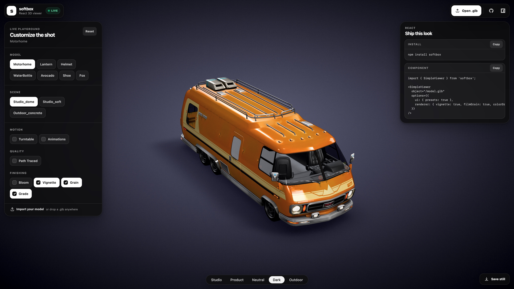

# softbox

<!-- The size badges are static (bundlephobia/bundlejs both mismeasure this
     multi-chunk package: they bundle `three`, our peer dep, or read the tiny
     re-export entry). Refresh the numbers from our own build after a release
     that changes the bundle:
       npm run build && for f in dist/*.js; do
         b=$(gzip -c "$f" | wc -c); awk -v b="$b" -v n="$f" 'BEGIN{printf "%s %.1f kB gzip\n", n, b/1000}'; done
     core = simple-viewer.es.js + the one chunk it imports statically
     (`from "./…"` at the top of the entry), since both load eagerly;
     ThreePathTracingService-* = the lazy path-tracer chunk. -->
[](https://www.npmjs.com/package/softbox)
[](https://github.com/LEMing/softbox#quality)
[](https://github.com/LEMing/softbox#quality)
[](https://github.com/LEMing/softbox/actions/workflows/ci.yml)
[](https://github.com/LEMing/softbox/blob/main/LICENSE)

**Studio product renders from a GLB, in one React component.**

The live 3D view on the page, the still for the catalog and the turntable clip for the product card all come out of the same component, lit the same way, from the model's real geometry. It runs in the browser, with no render farm, no scene to light by hand and no network request for the lighting.

```tsx
<SimpleViewer ref={viewerRef} object="/sofa.glb" preset="product" />
```

```ts
const still = await viewerRef.current.captureStill({ width: 2400 }); // PNG at any size
const clip = await viewerRef.current.captureVideo({ duration: 8 });  // WebM or MP4
```

[](https://leming.github.io/softbox/)

**▶ [Live playground](https://leming.github.io/softbox/)**: drop in your own `.glb`, switch presets and scenes, turn on path tracing, save a still.

## Made for products that are configured, not photographed

A fence at the height and length a customer picked. A sofa in one of forty fabrics. A pergola that exists only as an order. There is nothing to photograph yet, and a generated image cannot be trusted with the proportions. What you do have is the geometry, exported as a GLB or built in code as a `THREE.Object3D`.

softbox turns that geometry into the pictures a product page needs:

| You need | You write |
|---|---|
| A live view the customer can orbit | `<SimpleViewer object={model} />` |
| A catalog still at any resolution | [`captureStill({ width, height })`](#stills) |
| A photoreal still | [`pathTraced`](#photoreal-stills), then `captureStill()` |
| A turntable clip | [`turntable`](#video), then `captureVideo({ duration })` |
| An instant first paint | [`options.poster`](#poster), fed by a still rendered earlier |
| The same shot of every configuration | [`loadModel(next)`, then `captureStill()`](#every-configuration-one-shoot), in a loop |

Every model gets the same light, the same soft contact shadow and the same automatic framing, so a catalog rendered one configuration at a time still reads as one shoot.

## Is softbox the right tool?

Often it is not, and the alternatives are good.

- **AR comes first, or you are not on React.** Use Google's [`<model-viewer>`](https://modelviewer.dev/). It is a web component that works in any framework, and its AR goes further than softbox's handoff to Quick Look and Scene Viewer.
- **You are building a 3D scene, not presenting one product.** Use [react-three-fiber](https://r3f.docs.pmnd.rs/) with drei's `<Stage>`. You get a composable scene graph. softbox gives you one model on a stage and nothing to assemble.
- **You need rendered output, or one look across many models.** That is what softbox is for: path tracing and still and video export are built into the component, the studio lighting is procedural so it works offline, and it runs on React 18 as well as 19.

## Install

```bash
npm install softbox
```

Peer dependencies: `react` / `react-dom` `>=18 <20`, `three` `>=0.177 <0.188`.

Formerly published as [`threedviewer`](https://www.npmjs.com/package/threedviewer): renamed in 4.0.0 with the same API. See [MIGRATION_GUIDE.md](https://github.com/LEMing/softbox/blob/main/MIGRATION_GUIDE.md).

## Quick start

```tsx
import { useRef } from 'react';
import { SimpleViewer, type SimpleViewerHandle } from 'softbox';

function ProductShot() {
  const viewerRef = useRef<SimpleViewerHandle>(null);

  const saveStill = async () => {
    const link = document.createElement('a');
    link.href = await viewerRef.current!.captureStill({ width: 2400 });
    link.download = 'product.png';
    link.click();
  };

  return (
    <div style={{ width: '100%', height: 480 }}>
      <SimpleViewer
        ref={viewerRef}
        object="https://modelviewer.dev/shared-assets/models/RobotExpressive.glb"
        preset="product"
      />
      <button onClick={saveStill}>Save still</button>
    </div>
  );
}
```

The viewer fills its parent, so give the parent a size. `object` takes a URL or a `THREE.Object3D`:

```tsx
<SimpleViewer object={new THREE.Mesh(geometry, material)} />
```

With no options at all you get balanced studio lighting, a baked soft contact shadow that grounds the model, automatic framing, and DRACO, KTX2 and Meshopt decoding. The one-word props (`preset`, `turntable`, `animations`, `pathTraced`) cover the common cases, and [`options`](#configuration) reaches everything else.

## Rendering

### Stills

`captureStill()` resolves with a PNG data URL. It waits for a model that is still loading, so it is safe to call right after `loadModel()`.

```ts
const handle = viewerRef.current;

await handle.captureStill();                              // the canvas at its on-screen size
await handle.captureStill({ width: 2400 });               // 2400 px wide, height follows the canvas aspect
await handle.captureStill({ width: 2000, height: 2000 }); // exact size, rendered at that aspect
```

The still is rendered for the capture, not copied off the screen. It can be much larger than the visible canvas, up to the GPU's maximum texture size, and it carries any [finishing effects](#finishing) that are on.

### Photoreal stills

```tsx
<SimpleViewer ref={viewerRef} object={url} pathTraced />
```

`pathTraced` switches the viewer to progressive path tracing. While the camera moves you see ordinary raster frames, and when it rests the frame converges, then starts again from the next viewpoint. It works with every preset, including the default procedural studio. The tracer lives in a lazy chunk that is downloaded only when you turn it on.

```ts
const png = await viewerRef.current.captureStill(); // resolves once the frame has converged
```

In path-traced mode `captureStill()` waits for the accumulation to finish (`pathTracing.maxSamples`, 1024 by default) and returns the converged frame. Three things differ from raster stills:

- The still has the canvas's own pixel size, which is its CSS size times `renderer.pixelRatio`. Passing `width` or `height` rejects, so size the viewer for the output you need.
- A spinning turntable never converges, so a capture while `turntable` is on rejects. Stop it first.
- Finishing effects do not apply, because the tracer draws the frame itself.

To drive your own progress UI, listen for `pathtracing:complete`, which fires with `{ samples, totalTime }` when a frame converges.

### Video

```tsx
<SimpleViewer ref={viewerRef} object={url} turntable />
```

```ts
const clip = await viewerRef.current.captureVideo({ duration: 10 }); // Blob
```

`captureVideo()` records the live canvas through `MediaRecorder`, with no extra dependency: WebM in Chromium and Firefox, MP4 in Safari. It takes `duration` in seconds (3 by default), `fps` (30 by default), `mimeType` and `videoBitsPerSecond`.

The recording runs in real time and captures what the canvas shows, at the canvas's size. A moving camera always shows raster frames, so video is raster and path tracing is for stills. A full orbit takes 30 seconds at the default speed. Raise `options.controls.autoRotateSpeed` from its default of 2 for a shorter loop: 6 gives a 10-second orbit.

### Every configuration, one shoot

```ts
const handle = viewerRef.current;
const stills: Record<string, string> = {};

for (const item of catalog) {
  await handle.loadModel(item.model); // a GLB URL, or a THREE.Object3D built in code
  stills[item.sku] = await handle.captureStill({ width: 1600, height: 1200 });
}
```

`loadModel()` swaps the model on the same stage, frames it again and bakes its contact shadow, so the stills differ only in the product. A model built in code never touches the network.

### Poster

A poster image is the viewer's instant first paint. It shows until the model's first painted frame, then dissolves into the live scene:

```tsx
<SimpleViewer object={url} options={{ poster: '/hero.webp', loading: 'lazy' }} />
```

Generate posters with `captureStill()` and they match the live viewer exactly, since the same renderer made both. With `loading: 'lazy'` the page paints the poster with zero WebGL work, and the viewer boots only when it scrolls into view, which keeps LCP fast.

While it is opaque, the poster catches input, so nothing invisible underneath can be tapped. If the load fails, the poster stays up as the backdrop under the built-in error overlay. With `loadingIndicator: false` it steps aside instead, so a dead load never passes for a frozen hero image.

## Look

### Visual presets

One word sets a cohesive look: background, tone mapping exposure and environment intensity. Presets switch live, with no rebuild and no model reload.

```tsx
<SimpleViewer object={url} preset="product" />
// studio | product | neutral | dark | outdoor
```

Let your users switch presets with the built-in picker, which is off by default:

```tsx
<SimpleViewer object={url} options={{ ui: { presets: true } }} />
```

### Scenes

Presets grade the picture and scenes choose the set. `options.scene` selects the floor, the backdrop and how the studio environment is built. Unlike a preset, a scene is structural: switching one rebuilds the viewer.

```tsx
<SimpleViewer object={url} options={{ scene: 'outdoor_concrete' }} />
// studio_dome (default) | studio_soft | outdoor_concrete
```

- `studio_dome` is the default set: a shadow-catcher floor, the baked soft contact shadow and a crisp, contrast-pushed studio light with distinct highlights.
- `studio_soft` is the same set lit softly: an even, low-contrast wraparound light that flatters matte materials and softens speculars.
- `outdoor_concrete` is open air. A daylight HDRI lights the model and paints the sky, ground-projected so the model stands in the world, on a large photographic PBR concrete ground with untiled sampling, so no texture repetition shows at any distance. The HDRI and concrete maps (CC0, [Poly Haven](https://polyhaven.com/), about 6 MB on first view) come from their CDN by default. Override or self-host them through `environment.url` and `helpers.grid.styleOptions`. Offline, the ground falls back to a built-in procedural concrete and the lighting to the studio environment.

Scenes compose with presets: `scene` picks the set, `preset` grades it, and any explicit option you pass overrides both.

### Finishing

Four optional effects finish the raster frame. All are off by default, toggle live, and load their composer chunk only when the first one is turned on:

```tsx
<SimpleViewer
  object={url}
  preset="dark"
  options={{ renderer: { vignette: true, filmGrain: true, colorGrade: true } }}
/>
```

- `bloom` adds a restrained glow to highlights that are genuinely blown out.
- `vignette` darkens the frame edges to hold the eye on the subject.
- `filmGrain` lays a fixed, non-animated photographic grain over the frame.
- `colorGrade` lifts contrast and saturation after tone mapping. Pass `true` for a balanced default, or `{ contrast, saturation }` (roughly -1 to 1, where 0 changes nothing) to tune each.

### Backdrop and lighting at runtime

The handle changes the backdrop and the lighting after the viewer is up, without a rebuild:

```ts
await handle.setEnvironmentMap('/studio.hdr');  // an equirectangular HDRI lights the model and fills the background
handle.resetEnvironment();                      // back to the built-in studio
await handle.setBackgroundImage('/brand.jpg');  // a URL, File or HTMLImageElement, fitted like CSS object-fit: cover
handle.setBackgroundColor('#f4f1ec');           // a solid colour, which also clears a background image
```

`setBackgroundImage` changes only the backdrop and leaves the lighting alone. For a soft studio cove instead of a flat fill, set `backgroundColor` together with `backgroundColorEdge`: the backdrop becomes a radial gradient from the first, behind the subject, to the second in the corners.

### Material variants

Models that carry [KHR_materials_variants](https://github.com/KhronosGroup/glTF/tree/main/extensions/2.0/Khronos/KHR_materials_variants), colorways baked into one GLB, switch live with no rebuild and no reload:

```tsx
<SimpleViewer object={url} options={{ variant: 'beach' }} />
```

Enumerate and switch through the handle:

```ts
handle.getVariantNames();   // e.g. ['midnight', 'beach', 'street']
handle.setVariant('street');
handle.setVariant(null);    // back to the authored materials
```

`variant: null` is the declarative reset, while leaving the option out means "uncontrolled": a pick made with `setVariant()` survives unrelated option changes. Variant materials are prepared in the background right after load, so the first paint never waits for colorways nobody opened, and an early pick is applied the moment they are ready.

## Viewer

### Turntable

One word puts the model on a slowly rotating turntable. It pauses while the user drags and resumes on release. Toggling is live, like presets.

```tsx
<SimpleViewer object={url} turntable />
```

### Animations

One word plays everything the GLTF carries: all clips, looped, from the moment the model loads.

```tsx
<SimpleViewer object={url} animations />
```

Pick one clip, tune the speed, or build your own play and pause UI through the handle:

```tsx
<SimpleViewer object={url} options={{ animations: { autoplay: 'Walk', speed: 1.5 } }} />
```

```ts
handle.getAnimationNames(); // ['Walk', 'Idle', ...]
handle.pauseAnimations();
handle.playAnimations('Idle');
```

Turntable and animations compose: a spinning, walking robot is two words.

### Hotspots and click selection

Pin DOM content to a world-space point. It tracks orbiting, zooming and resizes:

```tsx
import { SimpleViewer, Hotspot } from 'softbox';

<SimpleViewer object="/model.glb">
  <Hotspot position={[0, 1.2, 0]}>
    <div className="pin">Engine</div>
  </Hotspot>
  <Hotspot position={[0.4, 0.2, 0.8]} occlude />
</SimpleViewer>
```

Without children a built-in dot pin is rendered. `occlude` hides the hotspot while the model blocks the line of sight to its anchor.

A click on the model (drags and pinches are ignored) emits `object:selected` with the hit object and the world-space point, ready to feed into a `<Hotspot>`:

```ts
handle.events.on('object:selected', ({ object, point }) => {
  addPin([point.x, point.y, point.z]);
});
```

Raycasts are BVH-accelerated per loaded model, so they stay fast on high-poly meshes. Opt out with `options.selection = { bvh: false }`.

### AR

One option puts an AR button over the canvas that opens the model in the platform's native AR viewer. There is no WebXR session and no extra bundle:

```tsx
<SimpleViewer object={url} options={{ ar: true }} />

// iOS AR Quick Look cannot read GLB, so give it the USDZ counterpart:
<SimpleViewer object={url} options={{ ar: { iosSrc: '/shoe.usdz', title: 'Runner' } }} />
```

- **Android** opens Scene Viewer straight from the model's own URL, so `ar: true` is enough. The model must be loaded from an **https** URL: a dropped `blob:` file has no address a native app could fetch, and Scene Viewer refuses plain http. Models swapped in with `loadModel()` are tracked, so the button always hands off the model that is on stage.
- **iOS** opens AR Quick Look from `iosSrc` (USDZ).
- **Desktop and unsupported devices** never render the button, so setting `ar` unconditionally is safe. On an Android-UA device that turns out to have no AR component (Quest, TV boxes), the failed handoff bounces back without a reload and the button retires itself.

`placement` picks the corner. It is `bottom-left` by default and lifts above the built-in preset picker on its own. Toggling `ar` never rebuilds the viewer or reloads the model.

### Loading

A built-in overlay shows while a model loads, and an error state if it fails, so the scene is never blank. Customize or disable it:

```tsx
<SimpleViewer object={url} options={{ loadingIndicator: { label: 'Loading…' } }} />
<SimpleViewer object={url} options={{ loadingIndicator: false }} /> // drive your own through events
```

`loading: 'lazy'` works like ``: the WebGL context and the model download wait until the viewer first approaches the viewport. On a page with many viewers only the visible ones boot. Browsers cap concurrent WebGL contexts, so an eager grid can silently kill its oldest viewers.

## Reference

### Imperative handle

```tsx
const viewerRef = useRef<SimpleViewerHandle>(null);
<SimpleViewer ref={viewerRef} object={url} />
```

| Member | What it does |
|---|---|
| `loadModel(source)` | Swaps the model: a URL or a `THREE.Object3D`. Resolves when it is on stage. |
| `captureStill(options?)` | Resolves with a PNG data URL. See [Stills](#stills). |
| `captureVideo(options?)` | Resolves with a video `Blob`. See [Video](#video). |
| `getVariantNames()` / `setVariant(name)` | [Material variants](#material-variants). |
| `getAnimationNames()` / `playAnimations(name?)` / `pauseAnimations()` | [Animations](#animations). |
| `setEnvironmentMap(url)` / `resetEnvironment()` | [Lighting at runtime](#backdrop-and-lighting-at-runtime). |
| `setBackgroundImage(source)` / `setBackgroundColor(color)` | [Backdrop at runtime](#backdrop-and-lighting-at-runtime). |
| `events` | The typed event emitter, below. |
| `scene`, `camera`, `renderer`, `controls` | The underlying three.js objects, for anything softbox does not cover. |
| `dispose()` | Tears the viewer down. Unmounting the component does this for you. |

Calls that cannot run reject or throw a `ThreeViewerError` with an `ErrorCode`, both exported from the package root.

### Events

```ts
const { events } = viewerRef.current;
const off = events.on('model:loaded', ({ model, loadTime }) => console.log('loaded in', loadTime, 'ms'));
off();
```

| Event | Fires |
|---|---|
| `model:loading` / `model:progress` / `model:loaded` / `model:error` | around every model load |
| `render:complete` | after each rendered frame |
| `pathtracing:complete` | when a path-traced frame converges (`{ samples, totalTime }`) |
| `controls:change` | when the camera controls move |
| `object:selected` | when a click hits the loaded model (`{ object, point }`) |
| `error` | on any viewer error |

### Configuration

Everything is optional, and the defaults are the point. Pass `options` to override any part. These are the defaults, abridged:

```ts
import { ControlType, type SimpleViewerOptions } from 'softbox';

const options: SimpleViewerOptions = {
  preset: 'studio',              // one-word look; explicit options below win over it
  scene: 'studio_dome',          // the set the model stands in
  backgroundColor: '#f0f0f7',
  staticScene: false,            // true stops the render loop when nothing moves

  // The unit your model is authored in: meters | centimeters | millimeters | feet | inches.
  // Other units are rescaled on load to the viewer's 1 unit = 1 meter convention, which the
  // floor, the shadows and the framing rely on. The model's own transform is left alone.
  units: 'meters',

  camera: { position: [60, 60, 60], fov: 30, autoFitToObject: true },

  // The procedural studio lights the scene with zero network requests.
  // Point environment.url at an HDR, EXR or image to use your own.
  environment: { environmentIntensity: 0.5 },

  // Khronos PBR Neutral tone mapping keeps saturated material colours through the highlights.
  renderer: { antialias: true, toneMappingExposure: 1.15 },

  controls: { type: ControlType.OrbitControls, enableDamping: true, autoRotate: false },

  helpers: {
    grid: { type: 'shadow_floor' }, // also: concrete_disc, hexagonal_glass, hexagonal_wire, square_wire, stone_tiles
    gizmo: false,                   // viewport orientation gizmo
    studioEnvironment: true,
  },

  pathTracing: { enabled: false, maxSamples: 1024 },

  ui: { presets: false },        // built-in preset picker
  selection: { bvh: true },      // BVH-accelerated raycasts for picking and occlusion
  loadingIndicator: true,        // built-in loading overlay; the object form customizes it
  loaders: {},                   // DRACO, KTX2 and Meshopt decoder config
  loading: 'eager',              // or 'lazy'
};
```

[`defaultOptions`](https://github.com/LEMing/softbox/blob/main/src/defaultOptions.ts) is exported and holds the full set. Every option interface is exported from the package root.

### Loaders

DRACO, KTX2/Basis and Meshopt decoders are wired into the glTF loader, so compressed exports from Blender, `gltfpack` or `gltf-transform` just load. Meshopt is bundled. The DRACO and KTX2 wasm decoders are fetched on demand, the first time a model actually uses that compression, from a version-pinned jsDelivr URL. For a fully offline setup, self-host the decoder directories:

```ts
loaders: {
  dracoDecoderPath: '/decoders/draco/',   // a copy of three/examples/jsm/libs/draco/
  ktx2TranscoderPath: '/decoders/basis/', // a copy of three/examples/jsm/libs/basis/
}
```

### Viewport gizmo

```ts
helpers: { gizmo: { placement: 'top-right', size: 128 } }
```

An interactive orientation cube: click it to snap the camera to an axis view. It stays in sync with the controls.

### Path tracing options

`pathTracing` takes `enabled`, `maxSamples` (the completion cap), `bounces`, `transmissiveBounces`, `renderScale`, `lowResScale` and `dynamicLowRes`. The converged frame stays on the live canvas and accumulates again after a camera move. `replaceWithScreenshotOnComplete: true`, off by default, restores the legacy behaviour of swapping in a DOM snapshot instead.

### Next.js and SSR

The viewer renders into a WebGL canvas, so it is client-only. In Next.js, load it dynamically:

```tsx
'use client';
import dynamic from 'next/dynamic';

const SimpleViewer = dynamic(
  () => import('softbox').then((m) => m.SimpleViewer),
  { ssr: false }
);
```

## Quality

- **Size.** The core is about 107 kB gzip, not counting `three`, which is a peer dependency. The path tracer adds 49 kB and the finishing effects a few more, each in a lazy chunk that loads only when the feature is turned on.
- **Tests.** Every release is gated by more than 1,100 unit tests and a Playwright suite that asserts real WebGL pixels in a browser, on both the newest and the oldest `three` the peer range accepts.
- **Types.** Every option, event payload and handle method ships TypeScript types, for ESM and CommonJS consumers alike.
- **Provenance.** Releases are published from CI with npm provenance.

## Upgrading

- **3.x → 4.0**: the package was renamed, and `threedviewer` is now **`softbox`**. Swap the dependency and the import specifier. The API is unchanged. See [MIGRATION_GUIDE.md](https://github.com/LEMing/softbox/blob/main/MIGRATION_GUIDE.md).
- **3.0 → 3.x**: additive all the way. Presets, `ui`, `pathTraced`, `captureStill`, `Hotspot`, `object:selected`, `selection`, `turntable` and `animations` are new surface on top of 3.0, and existing options keep working. The React peer is `>=18 <20`.
- **2.x → 3.0**: a breaking release that removed no-op APIs and moved to ESM plus CJS packaging. See [MIGRATION_GUIDE.md](https://github.com/LEMing/softbox/blob/main/MIGRATION_GUIDE.md).

Full history: [CHANGELOG.md](https://github.com/LEMing/softbox/blob/main/CHANGELOG.md)

## License

MIT
